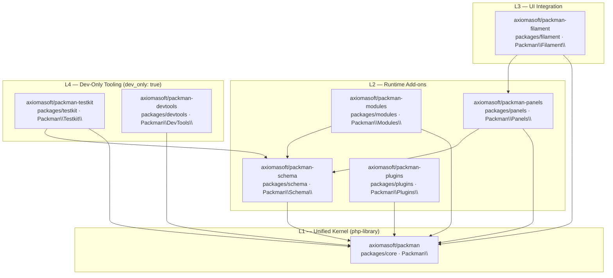

# Kernel Boundaries & Package DAG

**Monorepo:** `axiomasoft/packman-monorepo`  
**Kernel Package:** `axiomasoft/packman` (`packages/core`, PSR-4 root `Packman\`)

Packman separates universal runtime primitives (`packages/core`) from focused add-ons (`schema`, `plugins`, `modules`, `panels`), optional Filament UI adapters (`filament`), and `dev_only` testing/governance packages (`testkit`, `devtools`).

---

## 1. Strictly Acyclic 4-Layer Dependency DAG

Layer rank rules declared in [`packman.json`](../../packman.json) and enforced by `Packman\DevTools\Gates\Architecture\PackageGraphGate`:



### Hard Invariants Enforced by Gates

1. **No upward layer dependencies (`PackageGraphGate`):** A package in layer `Lx` may never `require` or import symbols from layer `Ly` where `y > x`.
2. **No dev-only leakage (`PackageGraphGate`):** Runtime packages (`L1`–`L3`) cannot `require` or import `dev_only: true` packages (`axiomasoft/packman-testkit`, `axiomasoft/packman-devtools`).
3. **Internal ownership (`OwnershipGate`):** Namespace-internal and `#[Internal]` types belong to their declared owner. Packman keeps separate owners for all eight packages. Products may explicitly group their own local runtime subpackages as described below; external dependencies cannot join those groups.
4. **Declared Composer edges (`PackageGraphGate`):** Any cross-package PHP `use` statement must correspond to an entry in `composer.json` `require` or `suggest`.

---

## 2. Pure-PHP Compatibility in `packages/core`

[`packages/core/composer.json`](../../packages/core/composer.json) requires only:

```json
{
    "require": {
        "php": "^8.4",
        "psr/clock": "^1.0"
    }
}
```

All `illuminate/*` packages live strictly in `"suggest"` (and root `"require-dev"` for test execution). `Packman\DevTools\Gates\Architecture\ModuleLayoutGate` enforces `"allow_laravel_required": false` for the `php-library` profile (`schemas/profiles/php-library.profile.json`).

### Pure PHP vs. Laravel Adapter Surface Inside `Packman\`

| Domain | Pure PHP 8.4+ Surface (zero `Illuminate\*`) | Optional Laravel Adapter Surface (`Laravel\`) |
|:--|:--|:--|
| `Attributes` | `Api`, `Spi`, `SpiKind` (`Implement`, `Call`), `Internal` | — |
| `Context` | `ContextScopeInterface`, `ContextResolverInterface`, `ActorResolverInterface`, `ScopeRef`, `ActorRef`, `ScopeUnavailableException` | — |
| `Errors` | `ErrorCode`, `DescribesError`, `ProblemDefinitionProvider`, `ProblemRegistry`, `ErrorDescriptor`, `ProblemDefinition`, `CoreErrorCode`, `ErrorCategory`, `UnavailabilityReason`, `CodedException`, `ProblemRegistryException`, `CompiledProblemRegistry` | `ErrorsRegistrar`, `ProblemDefinitions`, `ProblemRegistryFactory` |
| `Config` | `ConfigReader`, `ConfigReportSectionInterface`, `ConfigSection`, `OptionsFactory`, `RuntimeConfigCheck`, `SettingsLookup`, `CompileContext`, `SecretRef`, `TablePrefix`, `InvalidConfiguration`, `ConfigSections`, `SectionCompiler`, `JournalingConfigReader`, `DefinitionsCache`, `DefinitionsCodec` | `ConfigRegistrar`, `ConfigurationValidator`, `ConfiguredImplementation`, `RuntimeConfigGate`, `ConfigNormalizer`, `ValidateConfigCommand` |
| `Doctor` | `DoctorCheck`, `HealthCheck`, `DoctorRegistryContract`, `CheckResult`, `DoctorContext`, `DoctorFinding`, `DoctorReport`, `CheckStatus`, `Severity`, `DoctorReportBuilder` | `DoctorRegistrar`, `DoctorCommand` |
| `Extensions` | `ExtensionInspector`, `ExtensionFacetProfile`, all 10 `Contracts\*\With*` interfaces, all 10 `Concerns\*\*` traits | Hydrated automatically by `packman-plugins` and `packman-modules` |
| `Events`, `Features`, `Settings`, `Data` | `DomainEvent`, `FeatureFlagsInterface`, `FeatureFlagDefinition`, `NullFeatureFlags`, `SettingDefaultsProviderInterface`, `JsonDocument` | `JsonDocuments`, `JsonDocumentCast` |
| `Foundation` | `SystemClock` | `PackmanServiceProvider`, `ApplicationLocator`, `PackageRegistrar`, `RegistersPackageRegistrars`, `RegistersNothingOnBoot` |

---

## 3. Thin Providers & Optional Integrations

### Registrar Pattern (`Packman\Foundation`)

Every Laravel-enabled Packman package splits container wiring into focused `PackageRegistrar` classes implementing `register(Application $app): void` and `boot(Application $app): void`, orchestrated by `RegistersPackageRegistrars`:

- `PackmanServiceProvider` (`packages/core/src/PackmanServiceProvider.php`) wires `ErrorsRegistrar`, `ConfigRegistrar`, and `DoctorRegistrar`.
- `SchemaServiceProvider` (`packages/schema/src/Laravel/SchemaServiceProvider.php`) wires `DatabaseRegistrar`.
- `PluginsServiceProvider` (`packages/plugins/src/Laravel/PluginsServiceProvider.php`) wires `ExtensionRegistrar`.
- `ModulesServiceProvider` (`packages/modules/src/ModulesServiceProvider.php`) wires `RegistryRegistrar`, `LifecycleRegistrar`, `SettingsRegistrar`, `ModulesBootRegistrar`, and `ModulesRegistrar`.
- `PanelsServiceProvider` (`packages/panels/src/Laravel/PanelsServiceProvider.php`) wires `SavedViewsBindingsRegistrar` and `PanelsBindingsRegistrar`.
- `PackmanFilamentServiceProvider` (`packages/filament/src/PackmanFilamentServiceProvider.php`) wires `FilamentBindingsRegistrar` and `FilamentSecurityRegistrar`.

`ProviderSizeGate` keeps every `*ServiceProvider.php` at or below `provider_max_lines` (`80` lines across all library/platform profiles).

### Optional Cross-Package Bridges (`suggest` Dependencies)

- **`packman-panels` <-> `packman-modules`:** `PanelsBindingsRegistrar` binds `ModulePanelCatalogue` only when `interface_exists(ModuleRegistry::class) && interface_exists(EntityRegistry::class)` and both are bound in the container; otherwise it resolves `InMemoryPanelCatalogue`. Similarly, `SavedViewsBindingsRegistrar` binds `EntityViewSchemaProvider` when `EntityRegistry` is bound, falling back to `UnavailableViewSchemaProvider`.
- **`packman-panels` <-> `packman-plugins`:** `PanelsBindingsRegistrar` listens via `$app->afterResolving(PluginInspector::class, ...)` and inspects `ExtensionFacetProfile::$panelProviders` through `PanelExtensionBridge` when `PluginInspector` is present.
- **`packman-schema` <-> `packman-modules`:** `DatabaseRegistrar` binds `ModuleMigrationBoundary` only when present in the container, leaving standalone `SchemaMigrator` consumers independent of `packman-modules`.

---

## 4. Public API Classification

Every type in `packages/*/src` must declare one of:

- `#[Api(since: '1.0')]` — public caller/DTO API covered by SemVer guarantees and tracked in each package's `resources/contracts/php-api.json`.
- `#[Spi(kind: SpiKind::Implement|SpiKind::Call, since: '1.0')]` — extension/callback boundary (`Implement` for downstream implementations; `Call` for framework-invoked contracts/providers).
- `#[Internal]` — internal implementation excluded from SemVer and blocked across package boundaries.

## 5. Decisions shared with package authors and application owners

These decisions describe responsibilities rather than a required directory layout. A new
kernel mechanism needs multiple named consumers and a demonstrated common requirement.
Similar class names alone do not establish that requirement.

| Principle | Decision owner | Real example and problem solved | How to verify |
|:--|:--|:--|:--|
| Extract shared mechanisms; retain product rules. | Packman maintains the mechanism and its API/SPI; each package maintains domain policy. | Chatom, Vaulter and AzGuard need host-scoped activation and typed configuration. Their message pipelines, CAS ownership and authorization semantics remain separate. This avoids imposing one product's policy on another. | Run shared plugin contracts and the owners' message, content and authorization tests. Reject imports of internal types, including those marked by attribute outside an internal namespace. |
| Separate discovery, activation and first resource use. | Packages declare metadata; applications select activation; active functions obtain resources. | Disabled AzGuard does not inspect an invalid panel class. Commerz allocation and Billium compatibility reports need no connection. Declaring a schema executes no DDL. | Use ordinary Composer discovery in an archived Laravel application with no configured database. Check configuration, options, commands and resource access independently. |
| The host controls configuration and schema execution. | Packages declare config/schema and supported drivers; the host chooses sources, activation and the migration connection. | Vaulter retains installed schema metadata for inactive modules. Chatom rejects disabling mandatory core. Tenant rejects a second forced runtime owner. Host control respects these explicit constraints. | Keep two applications alive in one process, select different extensions/configuration, repeat registration as supported, then use retained services from the first host. Upgrade an existing installation and read its old records. |
| Product modules present their own concepts. | Corex owns its module interface and engine choice. | Installing `axiomasoft/corex-access` provides Corex access, scope, role and grant APIs. AzGuard panel and identity adapters are internal module choices. Corex-owned Eloquent wrappers are valid. | Install access with real dependencies; review application code using Corex contracts. Execute permission/scope tests and Corex Media store/read with Vaulter CAS. |
| Products retain their runtime and persistence models. | Each product owns its layout and storage guarantees. | Tenant core is portable PHP, Laravel owns guarded facilities, panels adapts admission, postgres owns physical templates and their schema. Sockit integrates Laravel and Eloquent directly. | Verify scoped Tenant and SQLite Sockit models separately from their PostgreSQL protocols. Keep subpackages in their existing repositories. |

For a public contract change, record the failing use case, affected callers and
implementers, compatibility decision and joint verification command. Update manifests
and consumers together. Prefer an existing supported SPI: configuration validators use
`ConfigSectionRegistration::registerValidator()`, rather than the internal doctor's tag.

The `0.1.2` review found no incompatible public signature change against `v0.1.1`.
Entity capability declarations are additive. The validator SPI already serves Chatom
and Vaulter Documents; Vaulter Drive uses the same boundary. Checks contributed to a
shared doctor registry need globally unique identities; a package may preserve legacy
diagnostic IDs in its own command.

### Explicit ownership within a product

The stricter attribute check exposed a real difference between independently governed
Packman packages and a product's implementation split across Composer subpackages.
Vaulter has 253 internal references involving 64 types across its runtime subpackages;
Proxyma's Filament adapter uses three core implementations in four places. Those
implementations are owned by their products and are not new extension contracts.

`gates.internal_ownership_groups` lets each of these products explicitly declare one
owner for its cooperating local runtime packages. For example:

```json
{
    "gates": {
        "internal_ownership_groups": {
            "proxyma": ["axiomasoft/proxyma-core", "axiomasoft/proxyma-filament"]
        }
    }
}
```

Only named packages in that inspected repository can join a group. Unknown packages,
duplicate membership and dev-only packages are rejected. A group permits internal
implementation use inside that owner; it does not bypass declared dependency edges,
layer checks or runtime/dev separation. External Packman internals remain forbidden.
Packman itself declares no groups and keeps eight independent package boundaries.

This additive devtools configuration solves the shared ownership need of Vaulter and
Proxyma without publishing 67 implementation types as public SPI. Their owners remain
responsible for compatibility of the package combinations allowed by their Composer
constraints. The application locks reviewed owner snapshots; a group does not make
unrelated source revisions compatible. The local command checks the current ownership
gate against all ten source roots as well as the archived runtime graph.

See [extension timing](extension-profiles.md#6-host-lifecycle-and-product-differences),
[migration authority](schema-governance.md#5-application-authority-and-upgrades) and
[local compatibility verification](quality-gates.md#4-local-ecosystem-compatibility).
