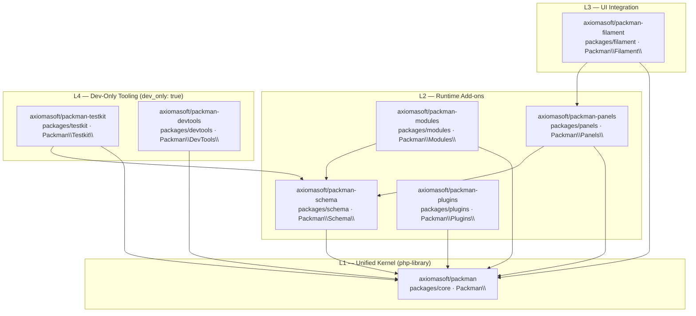

# Kernel Boundaries & Package DAG

**Monorepo:** `axiomasoft/packman-monorepo`  
**Kernel Package:** `axiomasoft/packman` (`packages/core`, PSR-4 root `Packman\`)

Packman separates universal runtime primitives (`packages/core`) from focused add-ons (`schema`, `plugins`, `modules`, `panels`), optional Filament UI adapters (`filament`), and `dev_only` testing/governance packages (`testkit`, `devtools`).

---

## 1. Strictly Acyclic 4-Layer Dependency DAG

Layer rank rules declared in [`packman.json`](../../packman.json) and enforced by `Packman\DevTools\Gates\Architecture\PackageGraphGate`:



### Hard Invariants Enforced by Gates

1. **No upward layer dependencies (`PackageGraphGate`):** A package in layer `Lx` may never `require` or import symbols from layer `Ly` where `y > x`.
2. **No dev-only leakage (`PackageGraphGate`):** Runtime packages (`L1`–`L3`) cannot `require` or import `dev_only: true` packages (`axiomasoft/packman-testkit`, `axiomasoft/packman-devtools`).
3. **Zero cross-package `\Internal\` imports (`OwnershipGate`):** Symbols in `*\Internal\*` or annotated `#[Internal]` belong strictly to their owning package.
4. **Declared Composer edges (`PackageGraphGate`):** Any cross-package PHP `use` statement must correspond to an entry in `composer.json` `require` or `suggest`.

---

## 2. Pure-PHP Compatibility in `packages/core`

[`packages/core/composer.json`](../../packages/core/composer.json) requires only:

```json
{
    "require": {
        "php": "^8.4",
        "psr/clock": "^1.0"
    }
}
```

All `illuminate/*` packages live strictly in `"suggest"` (and root `"require-dev"` for test execution). `Packman\DevTools\Gates\Architecture\ModuleLayoutGate` enforces `"allow_laravel_required": false` for the `php-library` profile (`schemas/profiles/php-library.profile.json`).

### Pure PHP vs. Laravel Adapter Surface Inside `Packman\`

| Domain | Pure PHP 8.4+ Surface (zero `Illuminate\*`) | Optional Laravel Adapter Surface (`Laravel\`) |
|:--|:--|:--|
| `Attributes` | `Api`, `Spi`, `SpiKind` (`Implement`, `Call`), `Internal` | — |
| `Context` | `ContextScopeInterface`, `ContextResolverInterface`, `ActorResolverInterface`, `ScopeRef`, `ActorRef`, `ScopeUnavailableException` | — |
| `Errors` | `ErrorCode`, `DescribesError`, `ProblemDefinitionProvider`, `ProblemRegistry`, `ErrorDescriptor`, `ProblemDefinition`, `CoreErrorCode`, `ErrorCategory`, `UnavailabilityReason`, `CodedException`, `ProblemRegistryException`, `CompiledProblemRegistry` | `ErrorsRegistrar`, `ProblemDefinitions`, `ProblemRegistryFactory` |
| `Config` | `ConfigReader`, `ConfigReportSectionInterface`, `ConfigSection`, `OptionsFactory`, `RuntimeConfigCheck`, `SettingsLookup`, `CompileContext`, `SecretRef`, `TablePrefix`, `InvalidConfiguration`, `ConfigSections`, `SectionCompiler`, `JournalingConfigReader`, `DefinitionsCache`, `DefinitionsCodec` | `ConfigRegistrar`, `ConfigurationValidator`, `ConfiguredImplementation`, `RuntimeConfigGate`, `ConfigNormalizer`, `ValidateConfigCommand` |
| `Doctor` | `DoctorCheck`, `HealthCheck`, `DoctorRegistryContract`, `CheckResult`, `DoctorContext`, `DoctorFinding`, `DoctorReport`, `CheckStatus`, `Severity`, `DoctorReportBuilder` | `DoctorRegistrar`, `DoctorCommand` |
| `Extensions` | `ExtensionInspector`, `ExtensionFacetProfile`, all 10 `Contracts\*\With*` interfaces, all 10 `Concerns\*\*` traits | Hydrated automatically by `packman-plugins` and `packman-modules` |
| `Events`, `Features`, `Settings`, `Data` | `DomainEvent`, `FeatureFlagsInterface`, `FeatureFlagDefinition`, `NullFeatureFlags`, `SettingDefaultsProviderInterface`, `JsonDocument` | `JsonDocuments`, `JsonDocumentCast` |
| `Foundation` | `SystemClock` | `PackmanServiceProvider`, `ApplicationLocator`, `PackageRegistrar`, `RegistersPackageRegistrars`, `RegistersNothingOnBoot` |

---

## 3. Thin Providers & Optional Integrations

### Registrar Pattern (`Packman\Foundation`)

Every Laravel-enabled Packman package splits container wiring into focused `PackageRegistrar` classes implementing `register(Application $app): void` and `boot(Application $app): void`, orchestrated by `RegistersPackageRegistrars`:

- `PackmanServiceProvider` (`packages/core/src/PackmanServiceProvider.php`) wires `ErrorsRegistrar`, `ConfigRegistrar`, and `DoctorRegistrar`.
- `SchemaServiceProvider` (`packages/schema/src/Laravel/SchemaServiceProvider.php`) wires `DatabaseRegistrar`.
- `PluginsServiceProvider` (`packages/plugins/src/Laravel/PluginsServiceProvider.php`) wires `ExtensionRegistrar`.
- `ModulesServiceProvider` (`packages/modules/src/ModulesServiceProvider.php`) wires `RegistryRegistrar`, `LifecycleRegistrar`, `SettingsRegistrar`, `ModulesBootRegistrar`, and `ModulesRegistrar`.
- `PanelsServiceProvider` (`packages/panels/src/Laravel/PanelsServiceProvider.php`) wires `SavedViewsBindingsRegistrar` and `PanelsBindingsRegistrar`.
- `PackmanFilamentServiceProvider` (`packages/filament/src/PackmanFilamentServiceProvider.php`) wires `FilamentBindingsRegistrar` and `FilamentSecurityRegistrar`.

`ProviderSizeGate` keeps every `*ServiceProvider.php` at or below `provider_max_lines` (`80` lines across all library/platform profiles).

### Optional Cross-Package Bridges (`suggest` Dependencies)

- **`packman-panels` <-> `packman-modules`:** `PanelsBindingsRegistrar` binds `ModulePanelCatalogue` only when `interface_exists(ModuleRegistry::class) && interface_exists(EntityRegistry::class)` and both are bound in the container; otherwise it resolves `InMemoryPanelCatalogue`. Similarly, `SavedViewsBindingsRegistrar` binds `EntityViewSchemaProvider` when `EntityRegistry` is bound, falling back to `UnavailableViewSchemaProvider`.
- **`packman-panels` <-> `packman-plugins`:** `PanelsBindingsRegistrar` listens via `$app->afterResolving(PluginInspector::class, ...)` and inspects `ExtensionFacetProfile::$panelProviders` through `PanelExtensionBridge` when `PluginInspector` is present.
- **`packman-schema` <-> `packman-modules`:** `DatabaseRegistrar` binds `ModuleMigrationBoundary` only when present in the container, leaving standalone `SchemaMigrator` consumers independent of `packman-modules`.

---

## 4. Public API Classification

Every type in `packages/*/src` must declare one of:

- `#[Api(since: '1.0')]` — public caller/DTO API covered by SemVer guarantees and tracked in each package's `resources/contracts/php-api.json`.
- `#[Spi(kind: SpiKind::Implement|SpiKind::Call, since: '1.0')]` — extension/callback boundary (`Implement` for downstream implementations; `Call` for framework-invoked contracts/providers).
- `#[Internal]` — internal implementation excluded from SemVer and blocked across package boundaries.
