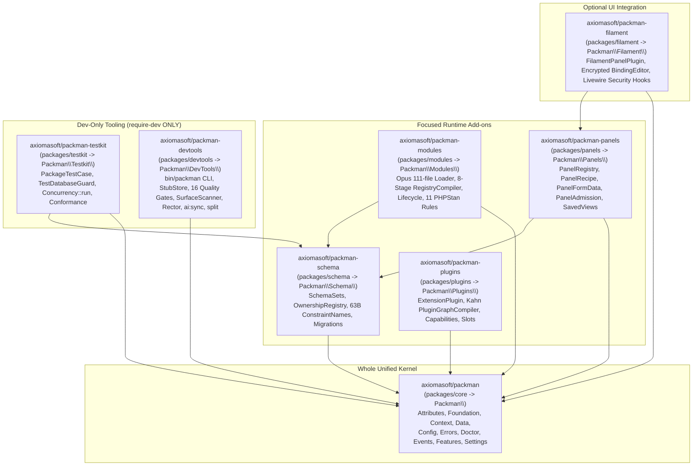

# 01. Packman Monorepo Architecture, Best Practices & Complete Tree

**Package:** `axiomasoft/packman-monorepo`  
**Stack:** PHP 8.4–8.5 · Laravel 13 · Pest 5 / PHPUnit 13 · PHPStan / Larastan 3 · Pint · Rector  
**Architecture Principle:** One whole unified kernel (`packages/core` -> `axiomasoft/packman`, PSR-4 root `Packman\`) plus focused modular add-ons (`modules`, `plugins`, `schema`, `panels`, `filament`, `testkit`, `devtools`).  
**Zero-Mention Rule:** Inside `packman` PHP/JSON/config code and public identifiers, there are **zero references to downstream host products**. `packman` is the universal ecosystem kernel; the reference modular platform and all sibling packages consume `packman`.

---

## 1. Package Extension Profiles & Acyclic Dependency DAG

### 1.1. The Four Package Profiles

Every repository and subpackage explicitly declares one of four profiles in `packman.json` and `schemas/profiles/*.profile.json`:

| Profile | Composer `type` | Extension / Runtime Model | Dependencies | Examples |
|:--|:--|:--|:--|:--|
| **`php-library`** | `library` | Pure PHP 8.4+ contracts, DTOs, exceptions; zero Laravel runtime required. | PHP 8.4+, `axiomasoft/packman` (core pure-PHP surface) | `tenant/packages/tenant`, `billium/packages/contracts` |
| **`laravel-package`** | `library` | Thin `ServiceProvider` + `PackageRegistrar`s; intra-package plugins/slots via `packman-plugins`; headless panels via `packman-panels`. | `axiomasoft/packman`, `packman-{plugins,schema,panels}` | `commerz`, `chatom`, `vaulter`, `azguard`, `proxyma`, `billium-core`, `sockit` |
| **`modular-platform`** | `library` + `module` consumers | Full Composer-discovered runtime module platform (`packman-modules`) using `ModuleDefinition`, 8-stage `RegistryCompiler`, `CompiledRegistry`, and lifecycle state (`mod_modules`, `mod_records`), while downstream packages declare Composer `type: "packman-module"` (or configured type like `"host-module"`). | `axiomasoft/packman`, `packman-{modules,schema,panels}` | Reference modular platform (and any future modular CMS/CRM/ERP platform) |
| **`product`** | `project` / `library` | Application / product composition root (`FlexCMS`, `FlexCRM`, SaaS apps). | Platform + domain packages | `flex/cms`, `flex/crm` |

---

### 1.2. Strictly Acyclic Dependency DAG (8 Subpackages)



**Dependency & Purity Invariants:**
- **Pure-PHP Compatibility in `packages/core` (`axiomasoft/packman`):** `Attributes`, `Context`, `Errors` (`Contracts`, `Data`, `Enums`, `CodedException`), `Events/DomainEvent`, `Features`, `Settings`, `Config/Contracts`, `Config/Data`, `Config/Exceptions`, and `Doctor/Contracts` are 100% pure PHP 8.4+ (`"require": {"php": "^8.4", "psr/clock": "^1.0"}`). Laravel `Illuminate\*` packages sit in `"suggest"` (and `"require-dev"` for tests); `Laravel\*` registrars and `PackmanServiceProvider` activate only when running in a Laravel container. This lets pure-PHP libraries (`axiomasoft/tenant`, `axiomasoft/billium-contracts`) depend on `axiomasoft/packman` without pulling in `laravel/framework`!
- **No Cycles Inside Kernel:** Within `packages/core`, `Errors` holds all error contracts, descriptors, enums, and `CodedException` in one cohesive zone (`Packman\Errors\*`), eliminating any cross-package cycle.
- **Optional `Panels ↔ Modules` Integration:** `packman-panels` works standalone without `packman-modules`. In `suggest`, `packman-panels` names `axiomasoft/packman-modules`; `PanelsBindingsRegistrar` binds `ModulePanelCatalogue` / `EntityViewSchemaProvider` only when `interface_exists(ModuleRegistry::class) && $app->bound(ModuleRegistry::class)`.
- **Dev Tooling Isolation:** `packman-testkit` and `packman-devtools` (including all 16 quality gates and scanners) never appear in `require` of any production package.

---

## 2. Exact Best Practices & Design Specifications Encoded in Each Package

### 2.1. `packages/core` — `axiomasoft/packman` (PSR-4: `Packman\`)

The unified ecosystem kernel containing 11 cohesive modules directly under `packages/core/src/`:

1. **`Packman\Attributes` (`src/Attributes/`):**
   - `#[Api(since: '1.0')]` — public caller/DTO surface; SemVer breaking-change protected.
   - `#[Spi(kind: SpiKind::Implement|SpiKind::Call, since: '1.0')]` — extension/implementation contract.
   - `#[Internal]` — excluded from SemVer promises; cross-package imports blocked by `PackageGraphGate`.
2. **`Packman\Foundation` (`src/Foundation/`):**
   - `Contracts\PackageRegistrar`: `register(Application $app): void`, `boot(Application $app): void`.
   - `Concerns\RegistersPackageRegistrars`: thin `ServiceProvider` iterates `protected const array REGISTRARS = [...]`, keeping providers under `ProviderSizeGate` limits (`<= 80` lines) with zero I/O in `register()`.
   - `Concerns\RegistersNothingOnBoot`: marker for pure bootless registrars.
   - `ApplicationLocator`: safe active-container lookup under Laravel Octane / resident workers.
3. **`Packman\Context` (`src/Context/`):** *(Replaces hard coupling to downstream tenant implementations)*
   - `Contracts\ContextScopeInterface`: `public function id(): string;`
   - `Contracts\ContextResolverInterface`: `public function current(): ?ContextScopeInterface;`
   - `Contracts\ActorResolverInterface`: `public function current(): ActorRef;`
   - `Data\ScopeRef` (`string $id, array $attributes = []`), `Data\ActorRef` (`string $type, ?string $id`).
   - `Exceptions\ScopeUnavailableException`.
4. **`Packman\Data` (`src/Data/`):** *(Extracted from the reference platform `packages/core/src/Data`)*
   - `Data\JsonDocument` (`canonicalJson` immutable wrapper), `Laravel\JsonDocuments` (`nullable`, `optionalArray`, `optionalMap`, `decode`), `Laravel\JsonDocumentCast`.
5. **`Packman\Config` (`src/Config/`):** *(Synthesizing `chatom`, `commerz`, reference platform, `azguard`, `vaulter`)*
   - **`Contracts\OptionsFactory`:** Every configurable package compiles a `final readonly class <Pkg>Options::fromArray(array $config, string $path): self` once at boot; domain services inject `<Pkg>Options`, never `config()`/`env()` or live `Repository`.
   - **`Laravel\ConfigurationValidator`:** Accumulates dotted-path violations (`add($path, $message)`) and throws `InvalidConfiguration` (`failIfAny()`).
   - **`Internal\JournalingConfigReader` & `CompileJournal` (`chatom`):** Typed extractors (`string`, `nullableString`, `int($min,$max)`, `float`, `bool`, `unsafeBool`, `enum`, `stringList`, `intList`, `stringMap`, `className`) collecting all errors in a single pass, redacting `/(secret|password|token|key)$/i`, and blocking `unsafeBool` in production without explicit opt-in.
   - **`Internal\SectionCompiler` & `ConfigSections` (`chatom` + `azguard`):** Subpackages claim root sections via `ConfigSections::own($root, $handler)` in `register()`. Seals on first read; `SectionCompiler` rejects any unknown key with **Levenshtein "did you mean?" typo suggestions**. Supports `REPLACEMENT_MAPS` (`vaulter`) where host-defined maps replace package defaults rather than merging.
   - **`Internal\DefinitionsCache` & `DefinitionsCodec` (`chatom`):** SHA-256 fingerprint over format + `InstalledVersions` + plugin file hashes + raw config + `CompileContext`; executes **round-trip codec verification** before atomic `tempnam` + `rename` + `opcache_invalidate`.
   - **`Data\SecretRef`, `Data\TablePrefix`** (regex `/\A[a-z][a-z0-9]{1,6}_\z/`), `Laravel\RuntimeConfigGate`, `Internal\Commands\ValidateConfigCommand`, `Contracts\ConfigReportSectionInterface`.
6. **`Packman\Errors` (`src/Errors/`):** *(RFC 9457 Problem Registry + `CodedException`)*
   - `Contracts\{DescribesError,ErrorCode,ProblemDefinitionProvider,ProblemRegistry}`
   - `Data\{ErrorDescriptor,ProblemDefinition}`, `Enums\{CoreErrorCode,ErrorCategory,UnavailabilityReason}`
   - `Exceptions\{CodedException,ProblemRegistryException}` (secret-masking + RFC 6901 `path`)
   - `Internal\{CompiledProblemRegistry,PackageProblemDefinitions,ProblemContribution}`, `Laravel\{ErrorsRegistrar,ProblemDefinitions,ProblemRegistryFactory}`.
7. **`Packman\Doctor` (`src/Doctor/`):** *(Synthesizing `chatom`, `vaulter`, `azguard`, `commerz`)*
   - `Contracts\{DoctorCheck,HealthCheck,DoctorRegistryContract}` (`code()`, `slice()` / `check()`)
   - `Data\{CheckResult,DoctorFinding,DoctorReport}`, `Enums\{CheckStatus,Severity}` (`Ok`, `Warning`, `Error`, `Skipped`; `DoctorFinding` enforces `remediation` + scalar-only `evidence`)
   - `Internal\DoctorRegistry`: dotted-segment exact prefix matching (`matching(array $prefixes)`), cascade skipping (`CheckStatus::Skipped` when base DB connection fails)
   - `Checks\{ConfigValidCheck,SchemaStatusCheck}`, `Laravel\Console\DoctorCommand` (`--json`, `--prefix`).
8. **`Packman\Events` (`src/Events/`):** `DomainEvent` abstract base (`eventId`, `occurredAt`, `scopeId`, `name()`).
9. **`Packman\Features` (`src/Features/`):** `Data\FeatureFlagDefinition`, `Contracts\FeatureFlagsInterface` (`define()`).
10. **`Packman\Settings` (`src/Settings/`):** `Contracts\SettingDefaultsProviderInterface` (`defaultFor()`, `isSensitive()`).
11. **`PackmanServiceProvider` (`src/PackmanServiceProvider.php`):** Thin provider wiring `ErrorsRegistrar`, `ConfigRegistrar`, `DoctorRegistrar` via `RegistersPackageRegistrars`.

---

### 2.2. `packages/modules` — `axiomasoft/packman-modules` (PSR-4: `Packman\Modules\`)

**The 111-file Reference Runtime Module Loader, Adapted with Zero Downstream Product References:**
- Preserves **100% of Opus's internal algorithms**:
  - `ModuleDefinition` & fluent `ModuleManifest`
  - `ModuleDiscovery` (Composer `installed.json` scan + `$fallbackModules` test seam)
  - 8-stage deterministic `RegistryCompiler` (`Entity → EntityField → Permissions → Api → Filament → Menu → Routes → Workflow`) producing SHA-fingerprinted `CompiledRegistry`
  - `CompiledModuleRegistry` (0 FS scans / 0 SQL queries on warm path via OPcache PHP artifact)
  - Transactional `DatabaseModuleLifecycle` with PG advisory lock, `mod_modules`, `mod_records` entity claims, `mod_lifecycle_log`, `EnableHook`, `DisableHook`, `PurgeHook`
  - All 11 AST PHPStan rules (`NoDirectSystemTableWriteRule`, `NoEvalRule`, `NoForeignPrefixSqlRule`, `NoFsOutsideModuleRule`, `NoListenNotifyRule`, `NoSessionAdvisoryLockRule`, `NoSetWithoutLocalRule`, `NoSqlPrepareRule`, `NoTempTableRule`, `AbstractDatabaseCallRule`)
- **All 29 external imports** rebound to `Packman\{Attributes,Context,Data,Config,Errors,Events,Features,Settings,Foundation}\*` and `Packman\Schema\*`. Audit trait wiring (`AuditCapabilityWiring`) is decoupled via post-entity-registry hook so host apps wire observers cleanly.
- **All 13 hardcoded strings** moved into `ModulesOptions`:
  - `$packageTypes = ['packman-module', 'packman-plugin', 'module', 'plugin']` (downstream Bitrix/WordPress-style modular platforms add e.g. `'host-module'`, `'host-plugin'`)
  - `$extraKeys = [['packman', 'module'], ['packman', 'plugin'], ['module'], ['plugin']]` (downstream platforms add e.g. `['host', 'module']`, `['host', 'plugin']`)
  - `$configRoot = 'modules'`, `$cachePath = 'bootstrap/cache/modules.php'`, `$cachePrefix = 'modules'`, `$lockKey = 'modules:lifecycle-graph'`
  - `$modulesTable = 'mod_modules'`, `$recordsTable = 'mod_records'`, `$lifecycleLogTable = 'mod_lifecycle_log'`
  - `$compilerPackage = 'axiomasoft/packman-modules'`
  - Artisan commands: `modules:compile`, `modules:why`, `modules:repair`; PHPStan rule IDs: `modules.*`.

---

### 2.3. `packages/plugins` — `axiomasoft/packman-plugins` (PSR-4: `Packman\Plugins\`)

Unified intra-package stateless code plugin, capability & slot engine combining `commerz`, `chatom`, `vaulter`, and `azguard` (**zero `illuminate/database` dependency — DB records are not required for code plugins**; modular hosts may optionally bind `PluginActivationGate`):
- **`ExtensionPlugin` (`manifest(): PluginManifest`, `register(PluginRegistrar $registrar): void`):** zero constructor args, zero I/O, zero DB, zero closures.
- **`PluginManifest`:** `id` (`vendor.name`), SemVer `version`, `requires`, `optional`, `resourceRoot`, `databases`.
- **`PluginActivationGate` (optional SPI):** Allows DB-backed hosts to gate active plugin IDs; standalone consumers rely on code/config `$disabled` lists with zero DB state.
- **`CapabilityDefinition` & `CapabilityProvider`:** `Cardinality` (`RequiredSingle`, `OptionalSingle`, `Many`), including `providesFromConfig($contract, $configKey, $default)` (`vaulter`).
- **`SlotDefinition` & `SlotContribution`:** `SlotKind` (`Guard`, `Restriction`, `Contributor`, `Handler`, `EventSink`, `OutboxConsumer`, `OperationMiddleware`, `PipelineStage`).
- **`PluginGraphCompiler`:** Seals `PluginRegistrar` after `register()`; validates `$disabled` and `PluginActivationGate`; runs **Kahn's topological sort** (`commerz`) with deterministic `SORT_STRING` tie-breaking, cycle isolation, **transitive ancestor ownership enforcement**, all-at-once `ContributionChecks` accumulation (`chatom`), and DB engine matrix validation.
- **`FrozenContributions` & `ExtensionRegistry`:** Immutable Octane-safe lookup (`get`, `has`, `keys`, `resolve`, `handler`, `handlerClass`).

---

### 2.4. `packages/schema` — `axiomasoft/packman-schema` (PSR-4: `Packman\Schema\`)

- **`SchemaSet` & `SchemaMigrator` (reference platform):** `SchemaSet(id, package, scope: Central|Tenant|Dedicated, lifecycle: Platform|Module, path, version, drivers, requires, connection)` tagged via `SchemaSetProvider`; zero `loadMigrationsFrom`.
- **`SchemaOwnershipRegistry` (`commerz`):** Longest-matching noun ownership + duplicate collision guard.
- **`ConstraintNames::shorten()` (`commerz`):** Deterministic 63-byte PostgreSQL identifier truncation (`substr($name, 0, 54) . '_' . substr(sha1($name), 0, 8)`).
- **`PackmanMigration` (`commerz`):** Enforces `_pk` naming, `uuidPrimary()`, `timestampsTz()` (`timestamptz(6)`), `money()`, `ref()` (`varchar(191)`).
- **`SchemaComponent` & `SchemaStep` (`chatom`) & `SchemaFingerprint` (`commerz`):** Pure schema steps with cycle check, dependency timestamp-ordering verification, and prefix+version SHA-1 state guard.

---

### 2.5. `packages/panels` & `packages/filament`

- **`Packman\Panels` (`packages/panels`):**
  - Two-phase `PanelRegistry` (`register`/`replace`/`configure`/`configureAll` -> atomic `freeze()` at `$app->booted(...)`), append-only `PanelRecipe` with origin precedence (`provider` < `plugin` < `configureAll` < `configure($id)`), `Panel::options(class-string<T>): ?T` (`azguard`).
  - `PanelDescriptor`, `PanelProvider`, `PanelContext`, `PanelAccess`, `PanelSlot`, `PanelFormData` (field inheritance, `clamped`, `minimum`, `maximum`, `clamped_by`, `editable`, `reason`, `editVersion` optimistic concurrency hash — `proxyma`).
  - `PanelAdmission` with graceful scoped navigation (`azguard`).
  - `SavedViews` contracts + SQL repository (reference platform `panels`) + optional `ModulePanelCatalogue` activated when `Packman\Modules` is bound.
- **`Packman\Filament` (`packages/filament`):**
  - `FilamentPanelPlugin` contract
  - `BindingEditor`: stateless `Crypt::encryptString` context signing across Livewire roundtrips + server-side dehydration edit enforcement (`proxyma`).
  - Security hooks from `azguard/filament`: `RefusesSurfaceBoot`, `RefusesSurfaceCalls`, `RefusesEditableColumns`, write-PDO verified bulk `AuthorizesActions`, `RefusesUnverifiableDownload`, `Livewire::addPersistentMiddleware`.

---

### 2.6. `packages/testkit` & `packages/devtools` (`require-dev` ONLY)

- **`Packman\Testkit` (`packages/testkit`):**
  - `PackageTestCase` (`migrateOncePerProcess` fingerprint cache — `chatom`), `TestDatabaseGuard` (blocks non-`_test` DBs via `SELECT current_database()`), `Concurrency::run($workers, $work)` (`pcntl_fork` + barrier files — `commerz`), `IsolatesDatabasePath`, `MigratesSchemaSets`, `AssertsCodedExceptions`, and automated Conformance traits (`Options`, `PluginContractTests`, `ModuleManifest`, `PanelProvider`, `ServiceProvider`).
- **`Packman\DevTools` (`packages/devtools`):**
  - **Scaffolding & CLI (`bin/packman`):** `new:monorepo`, `new:project`, `make:package`, `make:module`, `make:plugin`, `make:options`, `make:panel`, `make:schema-set`, `gate`, `php-api`, `error-codes`, `config-schema`, `split`, `ai:sync`, `doctor`.
  - **Scaffold Engine (`azguard/devtools`):** `StubStore` (fails on unresolved `{{ var }}` + Pint-sorted `use` imports), `Place`/`Layout`, AST tokenizer `ProviderRegistration`, 4-phase transactional `MakeCommand`.
  - **16 Parameterized Architecture & Quality Gates (`Gates/*` + `Surface/` + `Rector/`):** `GateRunner` reading root `packman.json` + `schemas/profiles/*.profile.json`; `PackageGraphGate` (`L1–L4` + no foreign `Internal`), `PackageDocsGate` (`PKG-001`), `ModuleLayoutGate`, `OwnershipGate` (`extra.packman.owns`), `AttributesArchitectureGate`, `PhpApiGate` (`resources/contracts/php-api.json`), `ErrorRegistryGate`, `ConfigCompositionGate`, `RuntimeGlobalsGate`, `ProviderSizeGate`, `NamingGate`, `SchemaGate`, `TableOwnershipGate`, `TableWriteOwnershipGate`, `QualityCeilingGuard`, `ExtensionContractGate`, plus `SurfaceScanner`, `ErrorSourceScanner`, custom Laravel Rector rules, base PHPStan/Pint/Rector presets, and positive/negative fixtures.
  - **Distribution & AI Sync:** `MonorepoSplitter` (`split.json`), `CompatibilityMatrixChecker` (`compatibility.json`), `EcosystemAiSynchronizer` (`ai:sync` with `--dry-run`, `--diff`, ownership checksums, preserving `*-reviewer-overrides.md` and never copying raw skills).

---

## 3. Complete File & Folder Structure of `packman` (8 Subpackages)

```text
/home/vostrikov/projects/packages/packman/
├── .agents/
│   ├── hooks.json
│   └── skills/                                         # Connected ecosystem skill plugin references
├── .antigravity/
│   ├── config.toml
│   └── hooks/lifecycle.py
├── .claude/
│   ├── agent-pack.lock.json
│   ├── review-gate.env.ini
│   ├── settings.json
│   ├── agents/{packman-api-surface,packman-orchestrator,packman-reviewer,packman-security-review,packman-slice-builder,packman-spec-writer,packman-test-verifier,packman-test-writer}.md
│   ├── guidelines/subagents-and-workflows.md
│   ├── hooks/review-gate.sh
│   ├── output-styles/lean.md
│   └── rules/{generated-assets,options-config,package-migrations,packman-reviewer-overrides,panels-and-slots,public-api,service-provider,tests}.md
├── .codex/
│   ├── config.toml
│   ├── hooks.json
│   └── agents/                                         # Valid Codex v0.169+ schema (BundledSkillsConfig / no unknown fields)
│       ├── packman-api-surface.toml                    # model = "gpt-6-astra"
│       ├── packman-reviewer.toml                       # model = "gpt-6-astra"
│       ├── packman-security-review.toml                # model = "gpt-6-astra"
│       ├── packman-slice-builder.toml
│       ├── packman-spec-writer.toml                    # model = "gpt-6-astra"
│       ├── packman-test-verifier.toml
│       └── packman-test-writer.toml
├── .github/workflows/{ci.yml,release-split.yml,reusable-package-ci.yml}
├── ai/                                                 # CANONICAL ECOSYSTEM AGENT-PACK & SKILL-PLUGIN
│   ├── README.md
│   ├── agent-pack.json
│   ├── plugin.json
│   ├── skills/
│   │   ├── ecosystem-architecture/
│   │   │   ├── SKILL.md
│   │   │   └── references/{taxonomy-and-profiles.md,package-graph-rules.md}
│   │   ├── ecosystem-package-scaffolder/
│   │   │   ├── SKILL.md
│   │   │   └── scripts/scaffold-package.php
│   │   ├── ecosystem-plugins-and-modules/
│   │   │   ├── SKILL.md
│   │   │   └── snippets/{ExtensionPlugin.stub.php,ModuleDefinition.stub.php}
│   │   ├── ecosystem-config-options/
│   │   │   ├── SKILL.md
│   │   │   └── snippets/{Options.stub.php,ConfigSection.stub.php}
│   │   ├── ecosystem-panels-filament/
│   │   │   ├── SKILL.md
│   │   │   └── snippets/{PanelProvider.stub.php,FilamentPlugin.stub.php}
│   │   ├── ecosystem-schema-ownership/
│   │   │   ├── SKILL.md
│   │   │   └── snippets/SchemaSets.stub.php
│   │   ├── ecosystem-public-api-semver/
│   │   │   ├── SKILL.md
│   │   │   └── snippets/CodedException.stub.php
│   │   ├── ecosystem-testing-lanes/
│   │   │   ├── SKILL.md
│   │   │   └── snippets/PackageTestCase.stub.php
│   │   └── ecosystem-astra-review/
│   │       ├── SKILL.md
│   │       └── scripts/{run-astra-review.sh,query-perplexity-mcp.sh}
│   ├── rules/{CLAUDE.template.md,AGENTS.template.md,generated-assets.md,options-config.md,package-migrations.md,panels-and-slots.md,public-api.md,service-provider.md,tests.md}
│   └── agents/{claude/*.template.md,codex/*.template.toml}
├── bin/{packman,php84}
├── docs/
│   ├── README.md
│   ├── dev-doctrine.md
│   ├── ecosystem-map.md
│   ├── migration-guide.md
│   ├── plans/
│   │   ├── 00-ecosystem-audit-and-golden-fund.md
│   │   ├── 01-packman-monorepo-architecture-and-tree.md
│   │   ├── 02-ecosystem-rollout-and-alignment-plan.md
│   │   ├── 03-gpt-6-astra-architectural-review.md
│   │   └── projects/{01-modular-platform.md .. 09-sockit.md}
│   ├── architecture/{constitution.md,dependency-dag.md,extension-profiles.md,namespace-and-bc-strategy.md,taxonomy.md,structure-profiles.md,api-policy.md,semver-policy.md,config-policy.md,panels-policy.md,schema-policy.md,data-ownership-policy.md,naming.md}
│   └── reference/{cli-commands.md,packman-json-schema.md,php-api-schema.md}
├── schemas/
│   ├── packman.schema.json
│   ├── php-api.schema.json
│   └── profiles/{php-library,laravel-package,modular-platform,product}.profile.json
├── packages/
│   ├── core/                                           # [1] axiomasoft/packman (Packman\ — Whole Unified Kernel)
│   │   ├── composer.json
│   │   ├── README.md
│   │   ├── CHANGELOG.md
│   │   ├── config/packman.php
│   │   ├── resources/contracts/php-api.json
│   │   ├── src/
│   │   │   ├── PackmanServiceProvider.php
│   │   │   ├── Attributes/{Api.php,Spi.php,SpiKind.php,Internal.php}
│   │   │   ├── Foundation/{ApplicationLocator.php,Contracts/PackageRegistrar.php,Concerns/RegistersPackageRegistrars.php,Concerns/RegistersNothingOnBoot.php}
│   │   │   ├── Context/{Contracts/ActorResolverInterface.php,Contracts/ContextResolverInterface.php,Contracts/ContextScopeInterface.php,Data/ActorRef.php,Data/ScopeRef.php,Exceptions/ScopeUnavailableException.php}
│   │   │   ├── Data/{Data/JsonDocument.php,Laravel/JsonDocuments.php,Laravel/JsonDocumentCast.php}
│   │   │   ├── Config/{Contracts/ConfigReader.php,Contracts/ConfigReportSectionInterface.php,Contracts/ConfigSection.php,Contracts/OptionsFactory.php,Contracts/RuntimeConfigCheck.php,Contracts/SettingsLookup.php,Data/CompileContext.php,Data/SecretRef.php,Data/TablePrefix.php,Exceptions/InvalidConfiguration.php,Internal/CompileJournal.php,Internal/CompiledSections.php,Internal/ConfigNormalizer.php,Internal/ConfigSections.php,Internal/DefinitionsCache.php,Internal/DefinitionsCodec.php,Internal/JournalingConfigReader.php,Internal/SectionCompiler.php,Internal/SectionRegistrar.php,Internal/Commands/ValidateConfigCommand.php,Laravel/ConfigRegistrar.php,Laravel/ConfigurationValidator.php,Laravel/ConfiguredImplementation.php,Laravel/RuntimeConfigGate.php}
│   │   │   ├── Errors/{Contracts/DescribesError.php,Contracts/ErrorCode.php,Contracts/ProblemDefinitionProvider.php,Contracts/ProblemRegistry.php,Data/ErrorDescriptor.php,Data/ProblemDefinition.php,Enums/CoreErrorCode.php,Enums/ErrorCategory.php,Enums/UnavailabilityReason.php,Exceptions/CodedException.php,Exceptions/ProblemRegistryException.php,Internal/CompiledProblemRegistry.php,Internal/PackageProblemDefinitions.php,Internal/ProblemContribution.php,Laravel/ErrorsRegistrar.php,Laravel/ProblemDefinitions.php,Laravel/ProblemRegistryFactory.php}
│   │   │   ├── Doctor/{Contracts/DoctorCheck.php,Contracts/DoctorRegistryContract.php,Contracts/HealthCheck.php,Data/CheckResult.php,Data/DoctorFinding.php,Data/DoctorReport.php,Enums/CheckStatus.php,Enums/Severity.php,Checks/ConfigValidCheck.php,Checks/SchemaStatusCheck.php,Internal/DoctorRegistry.php,Internal/DoctorReportBuilder.php,Laravel/DoctorRegistrar.php,Laravel/Console/DoctorCommand.php}
│   │   │   ├── Events/DomainEvent.php
│   │   │   ├── Extensions/
│   │   │   │   ├── ExtensionInspector.php
│   │   │   │   ├── Concerns/{Configuration/{Configurable,InteractsWithDatabaseSettings}.php,Persistence/{RegistersInDatabase,OwnsSchema}.php,Composition/{ProvidesCapabilities,ContributesToSlots,ProvidesPanels}.php,Runtime/{HasLifecycleHooks,ProvidesDiagnostics,DeclaresFeatureFlags}.php}
│   │   │   │   ├── Contracts/{Configuration/{WithConfiguration,WithDatabaseSettings}.php,Persistence/{WithDatabaseRegistration,WithSchema}.php,Composition/{WithCapabilities,WithSlots,WithPanels}.php,Runtime/{WithLifecycleHooks,WithDiagnostics,WithFeatureFlags}.php}
│   │   │   │   └── Data/ExtensionFacetProfile.php
│   │   │   ├── Features/{Contracts/FeatureFlagsInterface.php,Data/FeatureFlagDefinition.php}
│   │   │   └── Settings/Contracts/SettingDefaultsProviderInterface.php
│   │   └── tests/{Unit,Feature}/
│   │
│   ├── modules/                                        # [2] axiomasoft/packman-modules (Packman\Modules\ — 111-file Opus Loader)
│   │   ├── composer.json
│   │   ├── README.md
│   │   ├── CHANGELOG.md
│   │   ├── extension.neon                              # PHPStan configuration for the 9 Packman\Modules\PHPStan\Rules\{Boundaries,Pooling}\*
│   │   ├── config/modules.php
│   │   ├── database/migrations/tenant/                 # mod_modules, mod_records, mod_lifecycle_log migrations (registered via ModulesSchemaSets)
│   │   ├── resources/contracts/php-api.json
│   │   ├── src/
│   │   │   ├── ModulesServiceProvider.php
│   │   │   ├── Contracts/
│   │   │   │   ├── Compiler/{Extender,FieldCastRegistry,ManifestSectionCompiler,ModuleCompilation}.php
│   │   │   │   ├── Definition/{ModuleDefinition,ModuleDiscovery,ModuleRegistrar}.php
│   │   │   │   ├── Entities/{EntityRegistry,EntityRegistryHook}.php
│   │   │   │   ├── Lifecycle/{DisableHook,EnableHook,ModuleActivationGate,ModuleLifecycle,PurgeHook,RecordsRegistrar}.php
│   │   │   │   └── Registry/{ModuleRegistry,ModuleRegistryCache,ModuleStateReader,RegistryIntrospection}.php
│   │   │   ├── Data/
│   │   │   │   ├── Compiler/{CompiledEntityField,CompiledModule,CompiledRegistry,ExtensionReplacement,ExtensionStamp,InstalledPackageVersion,NormalizedExtension}.php
│   │   │   │   ├── Entities/{Entity,EntityDefinition,EntityField,FieldDefinition}.php
│   │   │   │   ├── Extenders/{Api,Permissions}.php
│   │   │   │   ├── Lifecycle/{ModuleManifest,ModuleRuntimeContext,ModuleStatus}.php
│   │   │   │   └── Registry/{ModuleExplanation,RegistryMap}.php
│   │   │   ├── Enums/
│   │   │   │   ├── ModuleErrorCode.php
│   │   │   │   ├── Entities/Capability.php
│   │   │   │   └── Lifecycle/{DisableReason,ModuleState}.php
│   │   │   ├── Events/Lifecycle/{ModuleArchived,ModuleDisabled,ModuleEnabled,ModulePurged,ModuleUpgraded}.php
│   │   │   ├── Exceptions/
│   │   │   │   ├── Compiler/{CompilationException,InvalidManifestException}.php
│   │   │   │   ├── Entities/{EntityNotFound,RegistryFrozen}.php
│   │   │   │   ├── Lifecycle/{HasEnabledDependentsException,InvalidStateTransitionException,MissingDependencyException,ModuleEnableFailedException,ModuleUpgradeFailedException}.php
│   │   │   │   └── Registry/{InvalidRegistryPoint,ModuleNotFound,RegistryInputUnavailable,StaleRegistryRevision}.php
│   │   │   ├── Internal/
│   │   │   │   ├── Commands/*
│   │   │   │   ├── Compiler/*
│   │   │   │   ├── Definition/*
│   │   │   │   ├── Discovery/*
│   │   │   │   ├── Entities/InMemoryEntityRegistry.php
│   │   │   │   ├── Events/*
│   │   │   │   ├── Extend/{Filament,Menu,Routes,Workflow}.php
│   │   │   │   ├── Gate/*
│   │   │   │   ├── Lifecycle/*
│   │   │   │   ├── Registration/ServiceProviderModuleRegistrar.php
│   │   │   │   ├── Registry/{ArrayModuleStateReader,CompiledModuleRegistry,ReadRegistryIntrospection,RepositoryModuleRegistryCache}.php
│   │   │   │   ├── Schema/ModulesSchemaSets.php
│   │   │   │   ├── Settings/*
│   │   │   │   └── Support/{ModulesConfigSection,ModulesOptions}.php
│   │   │   ├── Laravel/                                # ModulesRegistrar, LifecycleRegistrar, ModulesBootRegistrar, RegistryRegistrar, SettingsRegistrar
│   │   │   ├── PHPStan/Rules/
│   │   │   │   ├── Boundaries/{NoDirectSystemTableWriteRule,NoForeignPrefixSqlRule,NoFsOutsideModuleRule}.php
│   │   │   │   ├── Pooling/{AbstractDatabaseCallRule,NoEvalRule,NoListenNotifyRule,NoSessionAdvisoryLockRule,NoSetWithoutLocalRule,NoSqlPrepareRule,NoTempTableRule}.php
│   │   │   │   └── Support/DatabaseCall.php
│   │   │   └── Testing/                                # ArrayEntityRegistry, ExtensionContract
│   │   └── tests/{Unit,Feature,PHPStan,Stubs,Fixtures}/
│   │
│   ├── plugins/                                        # [3] axiomasoft/packman-plugins (Packman\Plugins\)
│   │   ├── composer.json
│   │   ├── README.md
│   │   ├── CHANGELOG.md
│   │   ├── resources/contracts/php-api.json
│   │   ├── src/
│   │   │   ├── Concerns/RegistersNothing.php
│   │   │   ├── Contracts/
│   │   │   │   ├── Contributions/{Capabilities,Contributions}.php
│   │   │   │   └── Registry/{ExtensionPlugin,PluginActivationGate,PluginInspector}.php
│   │   │   ├── Data/
│   │   │   │   ├── Capabilities/{CapabilityDefinition,CapabilityProvider}.php
│   │   │   │   ├── Contributions/{ContributionDescription,ContributionKind,SlotContribution,SlotDefinition}.php
│   │   │   │   └── Plugin/{PluginDescription,PluginManifest}.php
│   │   │   ├── Enums/
│   │   │   │   ├── PluginErrorCode.php
│   │   │   │   ├── Contributions/{Cardinality,SlotKind}.php
│   │   │   │   └── Plugin/PluginSource.php
│   │   │   ├── Exceptions/
│   │   │   │   ├── Graph/{InvalidExtensionGraphException,MissingExtensionException}.php
│   │   │   │   └── Registry/{RegistryFrozenException,UnsupportedContribution}.php
│   │   │   ├── Internal/
│   │   │   │   ├── Capabilities/CapabilitiesRegistry.php
│   │   │   │   ├── Contributions/{ContributionChecks,ExtensionRegistry,FrozenContributions}.php
│   │   │   │   └── Graph/{PluginCatalog,PluginDeclarations,PluginEntry,PluginGraphCompiler,PluginNode}.php
│   │   │   ├── Laravel/{ExtensionRegistrar,PluginRegistrar,PluginsServiceProvider,Console/ExtensionsCommand.php}
│   │   │   └── Testing/PluginGraph.php
│   │   └── tests/{Unit,Feature}/
│   │
│   ├── schema/                                         # [4] axiomasoft/packman-schema (Packman\Schema\)
│   │   ├── composer.json
│   │   ├── README.md
│   │   ├── CHANGELOG.md
│   │   ├── resources/contracts/php-api.json
│   │   ├── src/
│   │   │   ├── SpaceSchema.php
│   │   │   ├── Contracts/
│   │   │   │   ├── Compiler/{RetiresSteps,SchemaComponent,SchemaOwnership,SchemaStep}.php
│   │   │   │   └── Migration/{ModuleMigrationBoundary,SchemaMigrator,SchemaSetProvider,SchemaSets}.php
│   │   │   ├── Data/
│   │   │   │   ├── Compiler/{ConstraintNames,SchemaFingerprint,SchemaSpace,TableNames}.php
│   │   │   │   └── Migration/{SchemaMigrationStatus,SchemaSet}.php
│   │   │   ├── Enums/{IdStrategy,SchemaLifecycle,SchemaScope}.php
│   │   │   ├── Exceptions/{InvalidSchemaException,SchemaSetException}.php
│   │   │   ├── Internal/
│   │   │   │   ├── Commands/{MigrateSchemaCommand,SchemaStatusCommand}.php
│   │   │   │   ├── Compiler/{SchemaCompiler,SchemaOwnershipRegistry}.php
│   │   │   │   ├── Contracts/SchemaWriter.php
│   │   │   │   ├── Data/{CompiledSchema,PlannedStep,SchemaObject}.php
│   │   │   │   ├── Migration/{DefaultSchemaMigrator,TaggedSchemaSets}.php
│   │   │   │   └── Services/*
│   │   │   ├── Laravel/{DatabaseRegistrar,PackmanMigration,SchemaServiceProvider}.php
│   │   │   └── Testing/MigratesSchemaSets.php
│   │   └── tests/{Unit,Feature}/
│   │
│   ├── panels/                                         # [5] axiomasoft/packman-panels (Packman\Panels\)
│   │   ├── composer.json
│   │   ├── README.md
│   │   ├── CHANGELOG.md
│   │   ├── config/packman-panels.php
│   │   ├── database/migrations/tenant/
│   │   ├── resources/contracts/php-api.json
│   │   ├── src/
│   │   │   ├── Builder/{Panel,PanelBuilder,PanelProvider}.php
│   │   │   ├── Contracts/
│   │   │   │   ├── Admission/{PanelAdmissionGate,PanelAdmitter,PanelPolicyResolver}.php
│   │   │   │   ├── Registry/{PanelCatalogue,PanelPlugin,PanelProvider,PanelRegistry}.php
│   │   │   │   └── Subjects/{PanelFormProjector,PanelSubjectResolver,SubjectChainResolver}.php
│   │   │   ├── Data/
│   │   │   │   ├── Admission/{AdmissionResult,PanelAccess,PermissionDefinition}.php
│   │   │   │   ├── Panel/{PanelContext,PanelDescriptor,PanelFormData,PanelPluginContext,PanelReference,PanelSettings,PanelSlot}.php
│   │   │   │   └── Subjects/{EntityReference,SubjectChain,SubjectDescriptor,SubjectNode}.php
│   │   │   ├── Enums/
│   │   │   │   ├── PanelErrorCode.php
│   │   │   │   ├── Admission/{AssignmentScopeMode,TenantMode}.php
│   │   │   │   └── Panel/{Reads,StateRefresh}.php
│   │   │   ├── Exceptions/
│   │   │   │   ├── PanelException.php
│   │   │   │   ├── Definition/{DefaultPanelConflictException,DefinitionException,DuplicatePanelException,InvalidPanelIdException,PluginConflictException,PrefixConflictException,UnknownSlotException}.php
│   │   │   │   ├── Permissions/{DuplicatePermissionException,DuplicateRoleException,PolicyConflictException,UnknownPermissionException}.php
│   │   │   │   ├── Registry/{RegistryFrozenException,UnknownPanelException}.php
│   │   │   │   ├── SavedViews/SavedViewException.php
│   │   │   │   └── Subjects/SubjectResolutionFailed.php
│   │   │   ├── Internal/
│   │   │   │   ├── Admission/{PanelAdmission,PanelsProblemDefinitions}.php
│   │   │   │   ├── Catalogue/{CanonicalMetadata,InMemoryPanelCatalogue,ModulePanelCatalogue,PanelCatalog,PanelCompiler,PanelFingerprint,PanelRecipe,PanelRegistryImpl}.php
│   │   │   │   ├── Configuration/{PanelsOptions,PanelsSchemaSets}.php
│   │   │   │   └── Subjects/{EntityViewSchemaProvider,PanelFormProjection,PanelSubjects}.php
│   │   │   ├── Laravel/{PanelExtensionBridge,PanelsBindingsRegistrar,PanelsServiceProvider}.php
│   │   │   └── SavedViews/{Contracts/*,Data/*,Internal/*,Laravel/*}
│   │   └── tests/{Unit,Feature}/
│   │
│   ├── filament/                                       # [6] axiomasoft/packman-filament (Packman\Filament\)
│   │   ├── composer.json
│   │   ├── README.md
│   │   ├── CHANGELOG.md
│   │   ├── config/packman-filament.php
│   │   ├── resources/contracts/php-api.json
│   │   ├── src/
│   │   │   ├── PackmanFilamentPlugin.php
│   │   │   ├── PackmanFilamentServiceProvider.php
│   │   │   ├── Concerns/Authorization/{AuthorizesPage,AuthorizesRelationManager,AuthorizesResource,AuthorizesWidget}.php
│   │   │   ├── Contracts/{FilamentPanelPlugin,FilamentSurfaceGate}.php
│   │   │   ├── Enums/FilamentErrorCode.php
│   │   │   ├── Exceptions/
│   │   │   │   ├── FilamentException.php
│   │   │   │   └── Binding/{BindingAuthorizationException,BindingConflictException,InvalidBindingStateException}.php
│   │   │   ├── Forms/BindingEditor.php
│   │   │   ├── Internal/
│   │   │   │   ├── Configuration/FilamentOptions.php
│   │   │   │   ├── Errors/FilamentProblemDefinitions.php
│   │   │   │   ├── Reflection/ClassTraits.php
│   │   │   │   └── Surface/{DefaultFilamentSurfaceGate,FilamentContext}.php
│   │   │   ├── Laravel/{FilamentBindingsRegistrar,FilamentSecurityRegistrar}.php
│   │   │   └── Security/
│   │   │       ├── Authorization/{AuthorizesActions,AuthorizesExports,FilamentGate}.php
│   │   │       └── Surface/{RefusesEditableColumns,RefusesSurfaceBoot,RefusesSurfaceCalls,RefusesUnverifiableDownload}.php
│   │   └── tests/{Feature,Unit,Support,Fixtures}/
│   │
│   ├── testkit/                                        # [7] axiomasoft/packman-testkit (Packman\Testkit\, require-dev)
│   │   ├── composer.json
│   │   ├── README.md
│   │   ├── CHANGELOG.md
│   │   ├── src/
│   │   │   ├── PackageTestCase.php
│   │   │   ├── Concurrency.php
│   │   │   ├── TestDatabaseGuard.php
│   │   │   ├── Concerns/{AssertsCodedExceptions.php,IsolatesDatabasePath.php,MigratesSchemaSets.php}
│   │   │   └── Conformance/{ModuleManifestConformanceTrait.php,OptionsConformanceTrait.php,PanelProviderConformanceTrait.php,PluginContractTests.php,ServiceProviderConformanceTrait.php}
│   │   └── tests/
│   │
│   └── devtools/                                       # [8] axiomasoft/packman-devtools (Packman\DevTools\, require-dev — Scaffolding, 16 Gates & AI Sync)
│       ├── composer.json
│       ├── README.md
│       ├── CHANGELOG.md
│       ├── config/{phpstan-base.neon,pint.base.json,rector.base.php}
│       ├── stubs/{profiles/{php-library,laravel-package,modular-platform,product}/,monorepo/}
│       ├── src/
│       │   ├── DevToolsServiceProvider.php
│       │   ├── Scaffold/{StubStore.php,Layout.php,Place.php,GeneratedFile.php,ProviderRegistration.php}
│       │   ├── Surface/{SurfaceScanner.php,SurfaceReport.php,SurfaceDiagnostic.php}
│       │   ├── Errors/ErrorSourceScanner.php
│       │   ├── Generators/{ApiManifestGenerator.php,ConfigSchemaGenerator.php,ErrorCodeSchemaGenerator.php}
│       │   ├── Gates/{GateRunner.php,PackmanManifestReader.php,OwnersCatalogue.php,AttributesArchitectureGate.php,ConfigCompositionGate.php,ErrorRegistryGate.php,ExtensionContractGate.php,ModuleLayoutGate.php,NamingGate.php,OwnershipGate.php,PackageDocsGate.php,PackageGraphGate.php,PhpApiGate.php,ProviderSizeGate.php,QualityCeilingGuard.php,RuntimeGlobalsGate.php,SchemaGate.php,TableOwnershipGate.php,TableWriteOwnershipGate.php}
│       │   ├── Rector/Laravel/
│       │   ├── Distribution/{MonorepoSplitter.php,CompatibilityMatrixChecker.php,ReleasePreflightChecker.php}
│       │   ├── AiSync/EcosystemAiSynchronizer.php
│       │   └── Console/{MakeCommand.php,NewMonorepoCommand.php,NewProjectCommand.php,MakePackageCommand.php,MakeModuleCommand.php,MakePluginCommand.php,MakeOptionsCommand.php,MakePanelCommand.php,MakeSchemaSetCommand.php,RunGatesCommand.php,SyncEcosystemCommand.php,SplitMonorepoCommand.php}
│       └── tests/{Fixtures/{Positive,Negative}/,Unit/,Feature/}
├── fixtures/{standalone-php-consumer,standalone-laravel-consumer,modular-platform-consumer}/
├── scripts/{ci-local.sh,secret-scan-gate.sh,distribution/}
├── tests/{TestCase.php,Arch/PackmanArchitectureTest.php,Integration/}
├── AGENTS.md
├── CLAUDE.md
├── CHANGELOG.md
├── LICENSE
├── Makefile
├── README.md
├── compatibility.json
├── composer.json
├── packman.json
├── phpstan.neon
├── phpunit.xml
├── pint.json
├── rector.php
└── split.json
```
